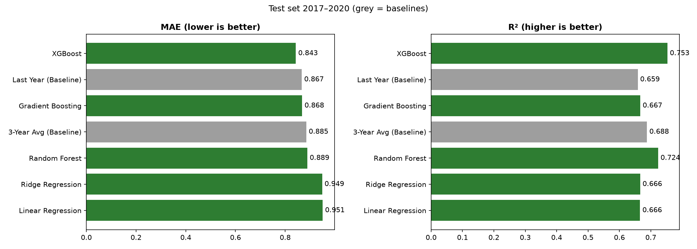
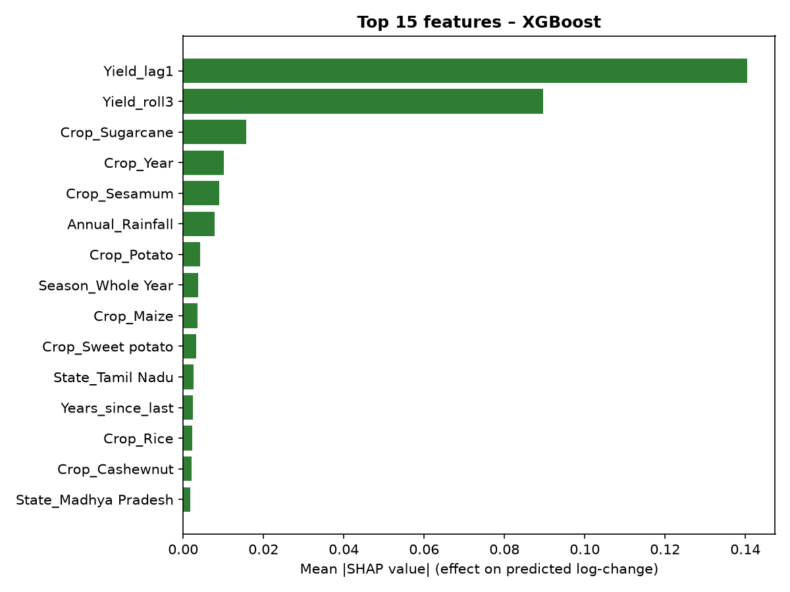
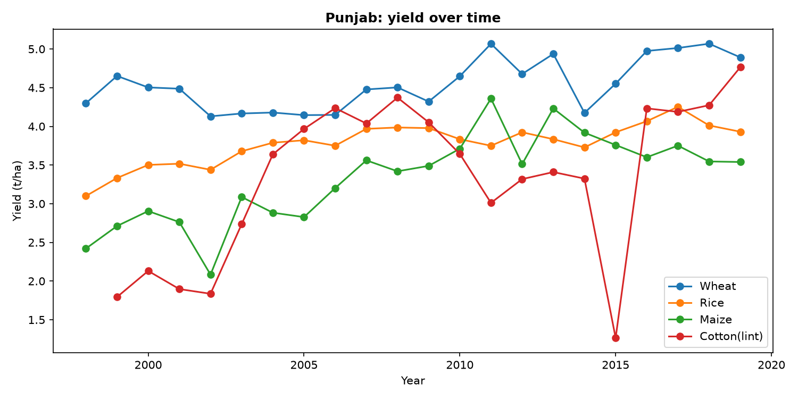

# AgriVision: Crop Yield Forecasting for Indian States

Forecasting next year's crop yield (tonnes per hectare) for each crop, state and season in India, and testing whether machine learning beats the obvious guess: "same as last year".

Includes a cleaned dataset, five regression models, two naive baselines, SHAP feature importance, a Punjab case study and a small Streamlit app.

## Dataset

The "Crop Yield in Indian States" dataset from Kaggle, 1997–2020: 19,689 rows, with one row per crop × season × state × year.

Columns: `Crop, Crop_Year, Season, State, Area, Production, Annual_Rainfall, Fertilizer, Pesticide, Yield`

### What I checked and decided

| Finding | Decision |
|---|---|
| All `Season` values and 172 `Crop` values have trailing spaces | Stripped |
| `Yield = Production / Area` (median ratio 0.996), and Production is only known after harvest | Production and Area are **not** used as inputs |
| `Fertilizer / Area` is exactly the same for every row within a year, so both columns are just Area × a yearly rate | Fertilizer and Pesticide are **not** used (they aren't real measurements) |
| Coconut yield is in nuts/ha (mean ≈ 8,600); every other crop is in t/ha (median ≈ 1) | Coconut removed (172 rows) |
| `Annual_Rainfall` is one value per state per year | Kept, but it is a weak signal |

## Approach

**Features.** The inputs are Crop, State and Season (one-hot encoded), plus Crop_Year, Annual_Rainfall and three **lag features** built from each crop/state/season's own past:
- `Yield_lag1`: yield in the previous recorded year
- `Yield_roll3`: average of the previous 3 recorded years
- `Years_since_last`: the gap to that previous record

Only earlier years are used (`groupby(...).shift(1)`), so no row ever sees its own or a future yield. The first year of each series has no history and is dropped, which leaves 17,845 rows.

**Target.** The models predict the **change from last year** on a log scale, `log(1+Yield) − log(1+Yield_lag1)` (roughly the % change), and this is converted back to t/ha. This puts sugarcane (~70 t/ha) and pulses (~0.7 t/ha) on the same footing.

**Split.** Train on 1997–2016 and test on 2017–2020 (unseen years). Tuning uses `TimeSeriesSplit` on the year-sorted training data.

**Models.** Linear Regression, Ridge, Random Forest, Gradient Boosting and XGBoost. Random Forest and XGBoost are tuned with `RandomizedSearchCV`.

**Baselines.** Each model is compared with two forecasts that need no ML:
- **Last Year:** this year's yield = last recorded yield
- **3-Year Avg:** this year's yield = mean of the last 3 recorded yields

## Results (test set 2017–2020, 3,155 rows)

| Model | MAE | RMSE | R2 | MdAPE_% |
|---|---|---|---|---|
| XGBoost | 0.843 | 7.230 | 0.753 | 9.340 |
| Last Year (Baseline) | 0.867 | 8.503 | 0.659 | 7.970 |
| Gradient Boosting | 0.868 | 8.403 | 0.667 | 8.250 |
| 3-Year Avg (Baseline) | 0.885 | 8.131 | 0.688 | 9.190 |
| Random Forest | 0.889 | 7.652 | 0.724 | 8.850 |
| Ridge Regression | 0.949 | 8.408 | 0.666 | 8.560 |
| Linear Regression | 0.951 | 8.414 | 0.666 | 8.660 |



MdAPE = median absolute percentage error.

**What the results show**

1. **XGBoost is the only model that beats both baselines on MAE, RMSE and R².** Compared with "same as last year": MAE 0.867 → 0.843 t/ha (2.8% lower), RMSE 8.50 → 7.23 (15% lower) and R² 0.659 → 0.753.
2. **The gain comes from the big misses.** The baseline has a lower *median* % error (8.0% vs 9.3%). For a typical, stable series, last year's yield is already a very good forecast. The model wins where yields swing sharply: Onion's MAE falls from 11.9 to 8.5 and Sesamum's from 0.37 to 0.16. For stable crops like rice and pulses it is roughly tied with, or slightly worse than, the baseline (see the table below).
3. **The linear models don't beat the baseline.** The change from year to year depends on interactions (crop × history) that a linear model can't capture.
4. **Before the lag features were added**, every model lost to the last-year baseline. Adding the yield history, and predicting the *change* instead of the raw yield, is what made ML useful here.

### Error by crop (10 most common crops)

| Crop | Last_Year_MAE | XGBoost_MAE |
|---|---|---|
| Arhar/Tur | 0.137 | 0.152 |
| Bajra | 0.335 | 0.341 |
| Groundnut | 0.178 | 0.187 |
| Maize | 0.419 | 0.450 |
| Moong(Green Gram) | 0.096 | 0.104 |
| Onion | 11.884 | 8.488 |
| Potato | 1.347 | 1.326 |
| Rice | 0.177 | 0.190 |
| Sesamum | 0.371 | 0.164 |
| Urad | 0.102 | 0.107 |

### Which features matter (SHAP, XGBoost)

Top features: `Yield_lag1`, `Yield_roll3`, `Crop_Sugarcane`, `Crop_Year`, `Crop_Sesamum`, `Annual_Rainfall`.

The model relies mostly on **last year's yield compared with the 3-year average**. In the training data, when last year was more than ~20% above the 3-year average, the next year's yield fell by a median of ~9%. This is mean reversion: unusually good or bad years tend to be followed by more normal ones. Crop type (for example Sugarcane and Sesamum) and rainfall add smaller adjustments. SHAP shows what the model uses; it is not evidence of cause and effect.



### Punjab (56 test rows)

| Model | MAE | RMSE | R2 | MdAPE_% |
|---|---|---|---|---|
| Last Year (Baseline) | 0.164 | 0.450 | 0.999 | 4.210 |
| Gradient Boosting | 0.179 | 0.526 | 0.999 | 4.870 |
| 3-Year Avg (Baseline) | 0.269 | 0.745 | 0.998 | 6.230 |
| Random Forest | 0.311 | 0.947 | 0.997 | 5.290 |
| XGBoost | 0.324 | 1.173 | 0.996 | 5.100 |
| Ridge Regression | 0.534 | 1.963 | 0.988 | 5.220 |
| Linear Regression | 0.538 | 1.978 | 0.988 | 5.150 |

In Punjab, yields are very stable (wheat and rice change little each year), so "same as last year" is the best forecast and Gradient Boosting comes closest. With only 56 rows, these numbers are noisy.



## Limitations

- **The forecast is one year ahead.** It needs last year's actual yield, and the rainfall input is the full year's total, which is only known at the end of the year.
- **The data is state-level,** so local soil, irrigation, seed variety and pest outbreaks are invisible to the model.
- **Rows with no history are dropped.** A crop/state/season seen for the first time can't be forecast.
- **Year has no effect beyond 2016.** Tree models can't extend a time trend past the last training year.

## Possible extensions

- Monsoon-season (June–September) rainfall instead of the annual total
- District-level data for more rows and finer detail
- Walk-forward evaluation across several test years

## Project structure

```
data/raw/crop_yield.csv     original dataset
src/inspect_data.py         first look at the raw data
src/preprocessing.py        cleaning, lag features, split, encoding
src/train_models.py         5 models + tuning
src/evaluate_models.py      metrics vs baselines, figures
src/explainability.py       SHAP feature importance
src/prediction.py           single prediction with input checks
app/app.py                  Streamlit app (Data / Predict / Results)
reports/                    result tables and figures
```

## How to run

```bash
pip install -r requirements.txt
python src/preprocessing.py
python src/train_models.py
python src/evaluate_models.py
python src/explainability.py
streamlit run app/app.py
```
